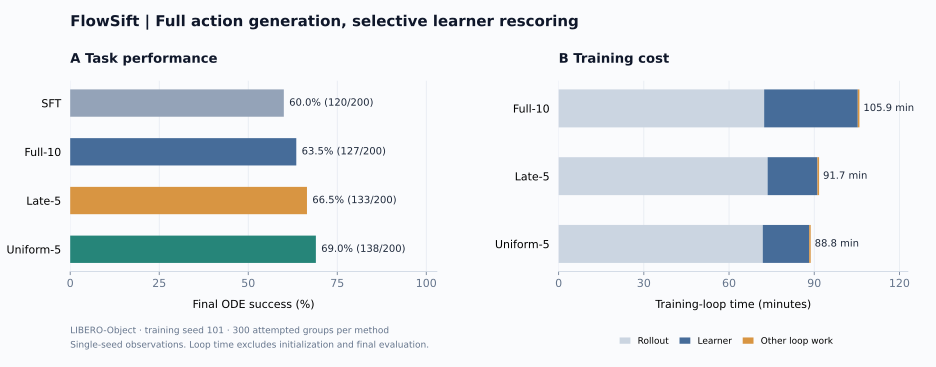
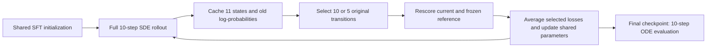

# FlowSift

### Measuring the cost–performance trade-off of selective GRPO updates for SmolVLA

[](https://github.com/ChengruiHan/FlowSift/actions/workflows/tests.yml)
[](LICENSE)

[Method](docs/method.md) · [Results](docs/results_and_limitations.md) · [Reproduce](#reproduce-the-results) · [Evidence](docs/experiments/seed101/README.md) · [Code review](docs/code_review.md)

**Can we reduce online VLA reinforcement-learning cost by updating from fewer denoising transitions while keeping full action generation?**

FlowSift studies this question on **SmolVLA + LIBERO-Object**. We implement selective transition rescoring inside the GRPO learner, compare **Full-10, Late-5 and Uniform-5**, and measure both fixed-workload learner cost and online task performance. Training still samples all **10 SDE transitions**; evaluation still uses **10-step ODE** generation.

## What we did

1. **Implemented a controlled three-method ablation.** Select transitions before current/reference forward passes, retain the original trajectory and time grid, and normalize both policy-gradient and k3 losses by the selected count.
2. **Verified the optimization mechanics.** Check upstream Full-10 equivalence, subset log-probabilities, actual denoiser call counts, masks, gradient paths and independent selection RNG. Enumerate all 252 five-step subsets on a small model to verify the mean loss and gradient identity.
3. **Separated compute savings from task outcomes.** Profile identical cached updates, then run three pilots and three formal runs under one attempted-group budget. Publish per-episode evaluations, cost breakdowns, provenance and the exact historical training source.

This is an implementation and empirical study built on [FlowVLA-RL](https://github.com/BlackMirean/FlowVLA-RL/tree/50e73afc07212f48bed370ea4c88a3131d6f914a). SDE retrofit, GRPO and uniform timestep subsampling are established ideas; our work is the selective-rescoring implementation, validation and measured comparison. See [attribution](UPSTREAM.md).

## Main findings



*One formal training seed (101), 300 attempted groups per method, 200 final evaluation episodes per model. Bars show observed values, not confidence intervals.*

| Model | ODE success | Successes / 200 | Training loop | Loop-time reduction vs Full |
|---|---:|---:|---:|---:|
| SFT | 60.0% | 120 | — | — |
| Full-10 | 63.5% | 127 | 105.9 min | — |
| Late-5 | 66.5% | 133 | 91.7 min | 13.4% |
| Uniform-5 | 69.0% | 138 | 88.8 min | 16.2% |

- **Rescoring work:** current/reference denoiser calls fall from **10/10 to 5/5 per chunk**.
- **Fixed-cache learner cost:** Late-5 reduces median update time by **46.9–48.0%**; Uniform-5 by **36.3–50.8%**, across three caches.
- **Online outcome:** both five-step methods have lower measured loop time and higher observed final success than Full-10 in this run. Uniform-5 records **+5.5 percentage points** relative to Full-10.

These observations support a useful cost–performance trade-off **in this experiment**. One training seed does not establish superiority or statistical non-inferiority. The update changes a shared denoiser, so unselected timesteps can also change. The selection mechanism does not reduce inference steps.

Training-loop time includes rollout, learner, diagnostics and checkpointing; it excludes initialization and final evaluation. Fixed-cache speedups cannot be read as equal reductions in total runtime or cloud cost. [Full results and limitations →](docs/results_and_limitations.md)

## Experiment design

The intervention is the set of stored transitions used by the learner. Both the policy-gradient and reference-regularization terms use that same set.

| Method | Rescored indices, zero-based | Current / reference calls per chunk |
|---|---|---:|
| **Full-10** | All indices: 0–9 | 10 / 10 |
| **Late-5** | Fixed low-noise end: 5–9 | 5 / 5 |
| **Uniform-5** | Five uniformly sampled indices, without replacement, independently per chunk | 5 / 5 |



| Controlled setting | Value |
|---|---|
| Initialization | Same author-provided `sft-100pct-baseline` for every method |
| Task suite | All 10 LIBERO-Object tasks; one multitask policy per run |
| Rollout | 10-step SDE, noise scale η=0.4, action chunk size 50 |
| Learner | G=4; centered binary rewards; one epoch; frozen SFT reference |
| Pilot | Seed 17, 100 attempted groups per method |
| Formal comparison | Seed 101, 300 attempted groups = 1,200 episodes per method |
| Final evaluation | Final checkpoint; 10-step ODE; 20 episodes/task; horizon 280 |
| Hardware | One RTX 4090 D, 24 GB; PyTorch 2.8.0+cu128 |

The budget was selected from the Full-10 pilot and locked before formal test evaluation. Collapsed groups consume budget but skip learning: Full/Late/Uniform complete **208/201/203 updates**. Equal attempted-group budgets do not imply equal environment steps or optimizer updates.

[Protocol](FlowSift-final-plan.md) · [Loss derivation and selection semantics](docs/method.md) · [Per-task results](docs/experiments/seed101/report/task_success.csv)

## Reproduce the results

### 1. Install and check the implementation

Python 3.12 is the tested version. These checks need no simulator, model download or GPU.

```bash
git clone https://github.com/ChengruiHan/FlowSift.git
cd FlowSift
python3.12 -m venv .venv
source .venv/bin/activate
python -m pip install -e '.[test]'
python -m pytest -q
python scripts/smoke_cpu.py --output results/cpu-smoke
python scripts/verify_cache.py --toy --output results/cpu-correctness.json
```

Use a fresh output directory for each smoke run. CPU toy timings validate execution and call counts; they are not SmolVLA performance measurements. The reviewed implementation has **112 passing CPU tests**, with Linux checks in GitHub Actions.

### 2. Verify the published evidence and rebuild tables

```bash
python scripts/verify_published_results.py
python scripts/summarize_results.py \
  --runs docs/experiments/seed101/runs \
  --evaluations docs/experiments/seed101/evaluations \
  --profile docs/experiments/seed101/gpu_profile/learner_profile.csv \
  --output results/reproduced-report
```

This checks the 76 evidence-file hashes, historical source hash, evaluation/checkpoint identity, success rates and training costs. It rebuilds reports from recorded data rather than rerunning training. [Evidence guide →](docs/experiments/seed101/README.md)

### 3. Run a new GPU experiment

Follow the [server training guide](docs/server_training.md) for Linux, CUDA, EGL, LIBERO and pinned LeRobot setup. The installer reuses a working PyTorch/CUDA stack where available.

```bash
bash scripts/setup_server.sh
source .venv/bin/activate
export MUJOCO_GL=egl
python scripts/prepare_model.py --output models/smolvla-source
```

The guide covers replay checks → cache collection → GPU correctness gate → fixed-cache profiling → pilots → budget lock → formal runs → final evaluation. Model weights are downloaded separately; scripts do not provision paid servers.

## Evidence and scope

- **Historical GPU experiment:** completed with a passed GPU cache-regression gate, fixed-cache profile, pilots, formal training and ODE evaluations. Exact source and hashes are archived with the results.
- **Reviewed implementation:** includes later fixes for early episode termination, provenance validation and recovery bookkeeping. CPU tests and CI pass; this version has **not been rerun on GPU**. New source requires a new GPU gate and protocol lock.
- **Limits:** one formal training seed, one SFT initialization, one task suite, and no strictly disjoint initial-state evaluation split. No universal ranking of timestep-selection strategies is claimed.

[Correctness evidence](docs/correctness_report.md) · [Post-experiment audit](docs/code_review.md) · [Detailed limitations](docs/results_and_limitations.md)

## Project layout

```text
src/flowvla_rl/            SDE, GRPO, selection, rollout, checkpoints and reporting
scripts/                  Training, evaluation, profiling and verification
configs/                  Three method configurations and environment constraints
tests/                    CPU regression tests and pinned upstream fixtures
docs/experiments/seed101/  Published measurements, logs and historical source
docs/assets/              Overview figure and its data-driven rendering script
docs/                     Method, results, protocol, audit and reproduction guides
toy/                      Inherited lightweight demonstrations
```

## Acknowledgments and license

FlowSift builds on [FlowVLA-RL](https://github.com/BlackMirean/FlowVLA-RL) and uses [LeRobot](https://github.com/huggingface/lerobot). The repository presentation follows the emphasis on readable experiments and accessible reproduction in [CleanRL](https://github.com/vwxyzjn/cleanrl) and LeRobot. Upstream research results are not presented as FlowSift measurements.

[MIT license](LICENSE) · [Source attribution](UPSTREAM.md) · [Contributing](CONTRIBUTING.md)
